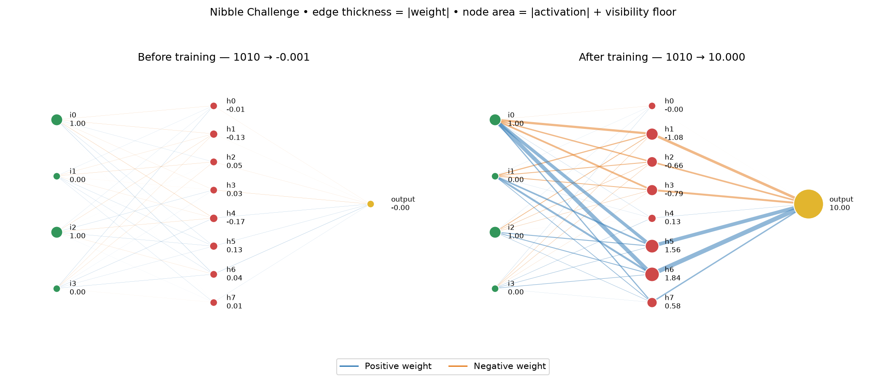
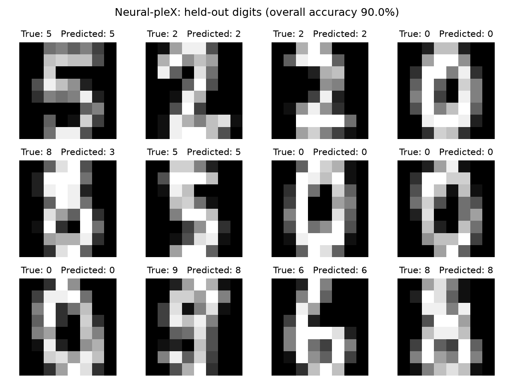
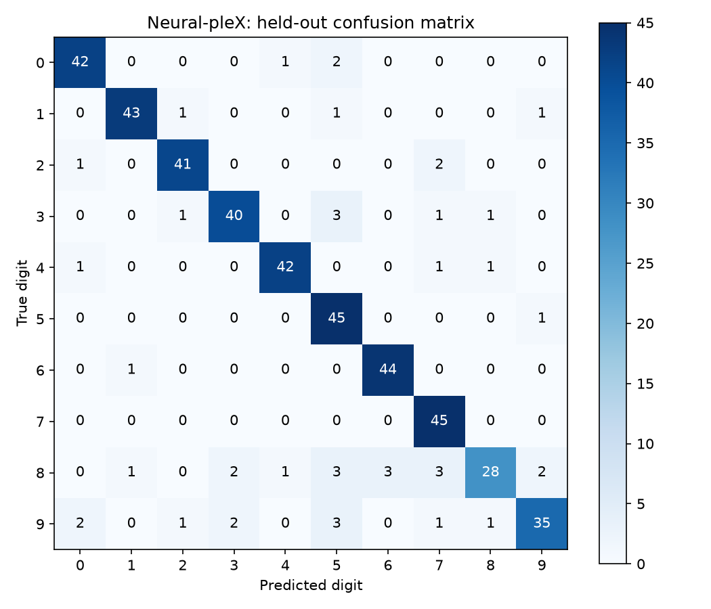

# Neural-pleX

[](https://pypi.org/project/neuralplex/)
[](https://pypi.org/project/neuralplex/)
[](LICENSE)

An object oriented educational/experimental neural network implementation.

## Introduction

**Neural-pleX** is an intuitive object oriented neural network implementation. The Neural-pleX API consists of Network, Layer, and Neuron constructors. The networks can be easily [visualized](#visualizations-of-the-network-before-and-after-training) using a visualization library.

## Table of contents

- [Installation](#installation)
- [Usage](#usage)
- [Example](#example)
- [Test](#test)
- [Digits experiment](#digits-experiment)

## Installation

```bash
git clone https://github.com/adamjpatterson/neuralplex.git
cd neuralplex
python -m pip install -e .
```

Install from this checkout to use the implementation documented below.

## Usage

This implementation demonstrates each component of the API. A 3 layer neural network is constructed that has a 4 neuron input Layer and a 1 neuron output layer. The hidden layer has 8 neurons.

### Implement a 3 layer neural network

#### Import the Network, Layer, and Neuron classes.

```python
from neuralplex import Network, Layer, Neuron
```

#### Set a step.

```python
STEP = 0.01
```

#### Construct a neural network by specifying the Neurons for each Layer and adding the Layers to a Network.

The resulting neural network will have 4 input neurons, 1 output neuron, and 8 neurons in the hidden layer.

```python
l1 = Layer(neurons=[Neuron() for i in range(0, 4)], step=STEP)
l2 = Layer(neurons=[Neuron() for i in range(0, 8)], step=STEP)
l3 = Layer(neurons=[Neuron()], step=STEP)
n1 = Network([l1, l2, l3], seed=13)
```

#### With the Network defined, you can train the network.

Here the network is trained to recognize the nibble 1111 as the decimal number 15.

```python
n1.train([1,1,1,1], [15])
```

You can generate and print a prediction using the `predict` method. Because the network underwent just one iteration of training, the estimate will likely be inaccurate. The accuracy of the prediction can be improved by iteratively training the network. Please see the [Train and Visualize a Neural-pleX Network](#train-and-visualize-a-neural-plex-network) implementation for an example of how to iteratively train the network.

```python
prediction = n1.predict([1,1,1,1])
print(prediction)
```

## Example

### Train and visualize a Neural-pleX network

Train the four-bit conversion network with a reproducible stream of examples:

```python
from random import Random

rng = Random(13)
for iteration in range(10000):
    number = rng.randrange(16)
    bits = [int(bit) for bit in f'{number:04b}']
    n1.train(bits, [number])
print(n1.predict([1, 0, 1, 0]))  # approximately [10.0]
```

To generate the complete before/after demonstration with
[D3Blocks](https://d3blocks.github.io/d3blocks/d3graph.html):

```bash
python -m pip install -e '.[visualization]'
python -m examples.nibble_visualization
```

Open `results/nibbles/index.html` in a browser. It contains two interactive
views of the same input, `1010`, with identical initial positions and scales.
Hover for signed weights, activations, and biases; drag to explore and reload
to restore the matching layout. These visual edits do not modify the model.
The optional visualization versions are pinned because the example adds fixed
positions to D3Blocks' generated HTML.

##### Visualizations of the network before and after training



- Edge thickness is proportional to the absolute connection weight. Blue is
  positive; orange is negative. Zero-weight edges have zero width.
- Node area above a small visibility floor is proportional to absolute activation.
  Green nodes are inputs, red nodes are hidden, and yellow is the output.
- Both panels use the same scales. Node size represents activity for this input,
  not importance, and does not encode the activation's sign.

The script also writes exact values and positions to `results/nibbles/snapshots.json`.
The PNG above is a static companion to the D3Blocks views; GitHub cannot run
interactive JavaScript in the README.


### How a neuron learns

Each computational neuron calculates
`activation(sum(source.value * weight) + bias)`. Inputs hold raw values.
`Neuron()` uses linear activation; `Neuron(activation="tanh")` is available for
hidden layers. Linear layers are sufficient for the nibble conversion task.

`train` minimizes half the sum of squared output errors. It runs the forward
pass, accumulates gradients backward through every connection, and only then
updates weights and biases. A weight's gradient is `delta * source.value`;
the bias gradient is `delta`. The code uses explicit loops, not automatic
differentiation. Every non-input neuron needs a positive step.

`Neuron(bias=...)` sets the bias. Each incoming connection has its own weight,
stored in `receiver.weights[source]`. `Network(..., seed=13)` initializes
weights reproducibly in [-0.1, 0.1]. Connections added
later accept an explicit `weight`; repeated connection calls preserve existing
weights. `get_edge_data` returns actual edges with signed weights, without
synthetic null-target edges. Give nodes unique names when visualizing them.

### Detach and reconnect between training steps

```python
hidden = n1.layers[1].neurons[0]
incoming = dict(hidden.weights)
outgoing = {target: target.weights[hidden] for target in hidden.neuronsRHS}
n1.detach(hidden)

# Restore the neuron, including its saved connection weights.
n1.layers[1].neurons.append(hidden)
for source, weight in incoming.items():
    source.connectRHS(hidden, weight=weight)
for target, weight in outgoing.items():
    hidden.connectRHS(target, weight=weight)
```

The neuron's bias, activation, and learning rate remain on the object. For one
edge, use `source.disconnectRHS(target)` and `source.connectRHS(target, weight)`.
Removing an edge does not cascade. A computational node without inputs uses
its bias; an empty hidden layer left by detachment is allowed. Connections must
run from earlier to later layers; input/output neurons cannot be detached.
Change structure only between training steps, not concurrently with training.

## Test

### How to run the Nibble Challenge

A model is trained that estimates a decimal value given a binary nibble.

#### Clone the repository.

```bash
git clone https://github.com/adamjpatterson/neuralplex.git
```

#### Change directory into the repository.

```bash
cd neuralplex
```

#### Install the package in editable mode.

```bash
pip install -e .
```

#### Run the Nibble Challenge on its own.

```bash
python -m unittest -v tests.test_nibbles
```

The test trains a fresh 4 → 8 → 1 network for 10,000 steps with a fixed random
seed. It prints predictions before and after training for all sixteen nibbles,
including `0000`, along with mean squared error and R². It checks that learning
reduces error, R² is at least 0.99, and every prediction is within 0.05 of its
decimal value. This demonstrates learning the conversion on the full nibble
domain; it is not a held-out generalization benchmark.

#### Run the correctness checks on their own.

```bash
python -m unittest -v tests.test
```

These check forward calculations, manual gradients, parameter updates,
detachment and reconnection, and input validation.

#### Run all tests.

```bash
python -m unittest -v
```

##### Output

The nibble challenge prints training progress and before/after predictions for
all sixteen inputs, followed by mean squared error and R².

## Digits experiment

Run a separate handwritten-digit experiment using the
[scikit-learn 8×8 digits dataset](https://scikit-learn.org/stable/modules/generated/sklearn.datasets.load_digits.html).
From the repository, install the optional dependencies and run:

```bash
python -m pip install -e '.[digits]'
python -m examples.digits
```

[examples/digits.py](examples/digits.py) uses the current multi-weight neurons
and manual backpropagation. The network has 64 input neurons, 16 tanh hidden
neurons, and 10 linear outputs. Each output learns a target of 1 for its digit
and 0 otherwise; the largest output selects the predicted digit. These scores
are not probabilities.

The experiment uses a fixed seed of 13 and a stratified 75%/25% split: 1,347
training images and 450 unseen test images. Pixel values are divided by 16.
Training runs for 20 epochs with a step of 0.001. Test images are evaluated only
after training and are not used to select parameters.

The example achieved **90.00% test accuracy** after 20 epochs, compared with
**10.22%** for always predicting the most common training digit. This is a
reproducible demonstration, not a claim about the best possible accuracy.

The script prints progress and the confusion matrix, then saves:

- `results/digits/report.txt`: configuration, accuracy, baseline, and confusion matrix.
- `results/digits/predictions.csv`: dataset index, true label, and prediction for each test image.
- `results/digits/predictions.png`: the first twelve test images and their predictions.
- `results/digits/confusion_matrix.png`: counts by true and predicted digit.

Generated results are ignored by Git and replaced on each run. The experiment
is separate from unit-test discovery and adds no runtime dependencies to the
core package.

### Digits predictions and confusion matrix

The prediction figure shows the first twelve test images, not selected
successes. The confusion matrix includes all 450 test images; rows show the
true digit and columns show the predicted digit. Both figures come from the
example above, using seed 13.





## Support

If you have a feature request or run into any issues, feel free to submit an [issue](https://github.com/adamjpatterson/neuralplex/issues). You’re also welcome to reach out to one of the authors.

- [Adam Patterson](https://github.com/adamjpatterson)
